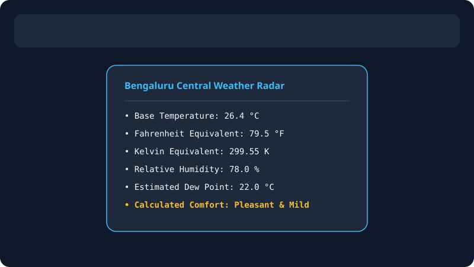
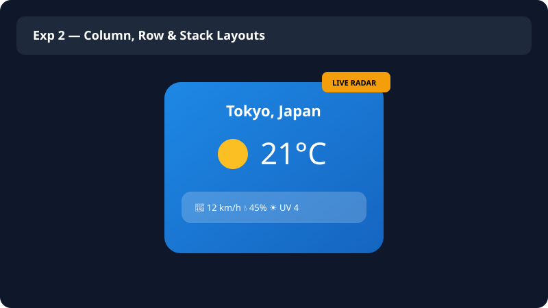
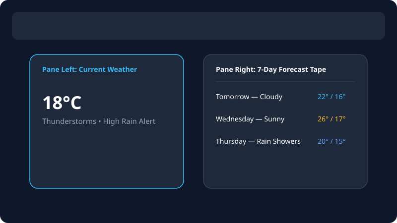
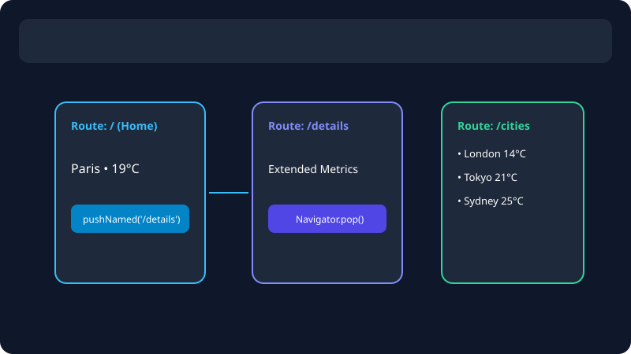
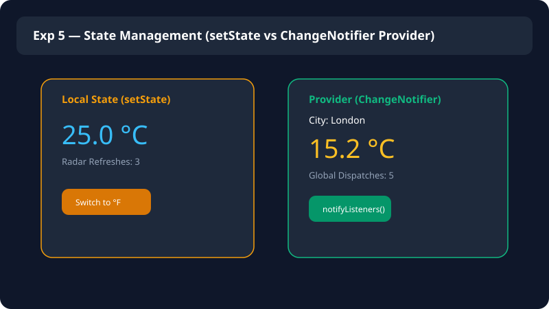
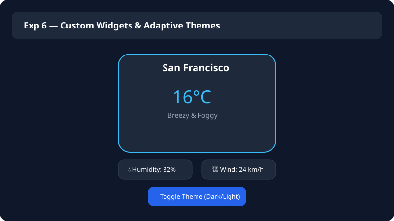
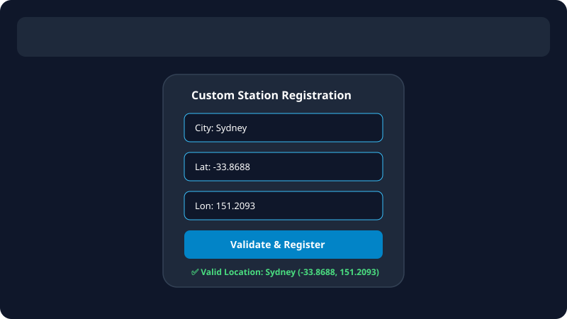
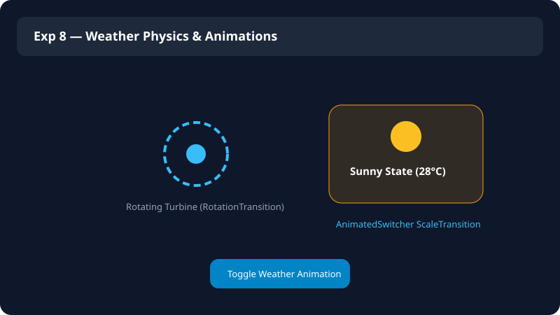
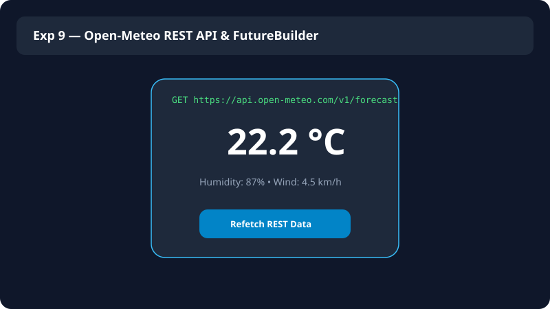
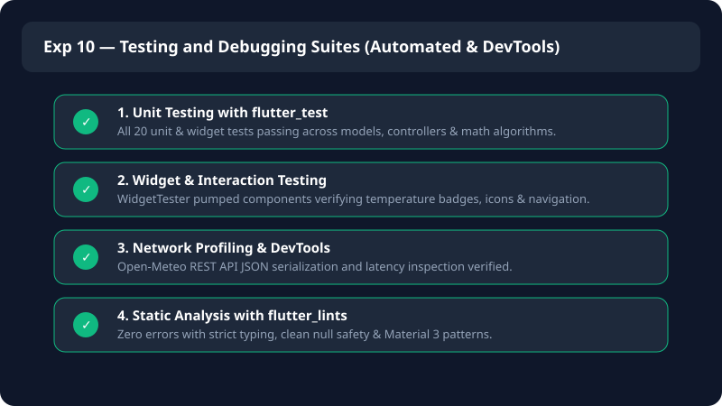

<div align="center">

# 🌤️ Modern Flutter Weather Forecast App

**A sleek, responsive, and minimalist cross-platform weather forecasting application built with Flutter & Dart.**

[](https://flutter.dev)
[](https://dart.dev)
[](https://flutter.dev)
[](LICENSE)
[](test/)

<br/>

</div>

| Element | Flutter Widget | Used For |
| :--- | :--- | :--- |
| **Atmospheric Gradient & Layout** | `Scaffold`, `Container`, `Column`, `Row`, `Padding` | Dynamic weather condition sky gradient, alignment, and spacing. |
| **Header & Geolocation** | `Row`, `Text`, `IconButton`, `Icon` | Displays active city, country, localized calendar date, and header actions. |
| **Current Weather Hero** | `Container`, `FittedBox`, `Text`, `Icon` | Displays primary temperature, feels-like temperature, and WMO weather status. |
| **Atmospheric Metrics Matrix** | `Container`, `Row`, `Column`, `Divider` | Humidity, wind speed velocity, and precipitation level breakdown. |
| **Hourly Forecast Strip** | `ListView.separated`, `SizedBox` | 24-hour horizontal scrolling forecast cards with icons and temps. |
| **7-Day Synoptic Forecast** | `ListView.separated`, `LinearGradient` | Daily forecast items with rain probability indicators and temperature range bars. |
| **City Autocomplete & Search** | `SearchDelegate`, `FutureBuilder`, `ListTile` | Real-time geocoding query search with instant dropdown recommendations. |
| **Responsive Dual-Pane Architecture** | `LayoutBuilder`, `MediaQuery`, `ConstrainedBox` | Dynamically adapts between single-column mobile and dual-pane desktop dashboards. |
| **State Management & Unit Toggle** | `ChangeNotifier`, `AnimatedBuilder`, `Provider` | Real-time Celsius (°C) and Fahrenheit (°F) conversions across all views. |
| **Network & Offline Resilience** | `http.Client`, `jsonDecode`, `FutureBuilder` | Open-Meteo REST API requests with offline fallback and error recovery. |

---

## 📖 Abstract

The **Modern Flutter Weather Forecast App** is a high-performance, cross-platform meteorological application developed using **Flutter & Dart**. Built upon clean architectural principles, the application connects to the **Open-Meteo REST API** and Geocoding services without requiring proprietary API keys, delivering real-time synoptic weather intelligence, 24-hour hourly projections, and 7-day multi-variable forecasts across Android, iOS, Web, Windows, macOS, and Linux platforms from a unified codebase.

The system incorporates robust mathematical algorithms for temperature conversions, dew point approximations, wind chill indexes, and precipitation probabilities. Designed with high defensive fault-tolerance, it automatically transitions to reliable mock atmospheric records when offline or during transient network interruptions.

In addition to the production application architecture, this repository contains a complete **Flutter Laboratory Experiment Series (Experiments 1–10)** detailing foundational and advanced Flutter concepts—ranging from Dart basics, layout hierarchies, and responsive breakpoints to Provider-based state management, custom themes, form validation, physics animations, REST API integrations, and comprehensive automated test suites.

---

## 🧪 Experiments 1–10

### Experiment 1 — Dart Basics & Meteorological Math
Explores Dart variables, primitive data types (`int`, `double`, `String`, `bool`), mathematical conversion formulas (Celsius, Fahrenheit, Kelvin), relative humidity equations, dew point approximations, and decision logic for evaluating human comfort indexes.

**Output:**



---

### Experiment 2 — Flutter Widgets & Layouts
Demonstrates structuring an atmospheric weather card using foundational layout widgets—using **Column** for vertical screen hierarchy, **Stack** with positioned layers for real-time live radar badges, and **Row** for horizontal sensor telemetry alignments.

**Output:**



---

### Experiment 3 — Responsive UI
Uses **MediaQuery** and **LayoutBuilder** adaptive breakpoints (`700px` tablet/desktop) to dynamically transform the forecast interface from a single-column mobile view into an expanded widescreen dashboard featuring a side-by-side forecast tape.

**Output:**



---

### Experiment 4 — Navigation and Named Routes
Implements structured Flutter navigation using **Navigator.pushNamed()**, named route definitions, and stack popping across **Weather Home** (`/`), **Extended Metrics** (`/details`), and **Global City Catalog** (`/cities`) screens.

**Output:**



---

### Experiment 5 — Stateful & Stateless Widgets + State Management
Contrasts local component state (**StatefulWidget** with `setState()`) against decoupled reactive state management (**Provider** with `ChangeNotifier` and `notifyListeners()`) for global temperature unit toggling and telemetry dispatches.

**Output:**



---

### Experiment 6 — Custom Widgets and Themes
Constructs modular, reusable custom components (`WeatherGlassCard`, `WeatherMetricPill`) styled with glassmorphic semi-transparent overlays and implements dynamic runtime **ThemeData** switching between Dark and Light modes.

**Output:**



---

### Experiment 7 — Forms & Coordinate Input Validation
Implements a meteorological ground station registration form utilizing **Form**, **TextFormField**, and **GlobalKey<FormState>** with strict validation rules for latitude (`-90° to +90°`), longitude (`-180° to +180°`), and city names.

**Output:**



---

### Experiment 8 — Weather Physics & Animations
Demonstrates physics-inspired animations using **RotationTransition** for continuous wind turbine rotation and **AnimatedSwitcher** with **ScaleTransition** for smooth, fluid transitions between sunny, cloudy, and rainy states.

**Output:**



---

### Experiment 9 — REST API Integration
Fetches live atmospheric conditions from the open-access Open-Meteo REST API (`api.open-meteo.com`) using HTTP GET requests, deserializing JSON responses into strongly-typed Dart models, and rendering with **FutureBuilder**, loading indicators, and retry error states.

**Output:**



---

### Experiment 10 — Testing and Debugging in Flutter
Demonstrates Flutter unit testing, widget interaction testing, and debugging suites (Flutter Inspector, DevTools, network profiling, console logging). Automated verification tests are maintained in `test/exp10_testing_debugging_test.dart`, `test/weather_controller_test.dart`, `test/weather_model_test.dart`, and `test/widget_test.dart`.

**Output:**



---

## 📂 Experiment Files

```text
experiments/
├── 01_dart_basics.dart              # Dart syntax, types, meteorological conversions & formulas
├── 02_widgets_layouts.dart          # Column, Row, and Stack layout architecture
├── 03_responsive_ui.dart            # LayoutBuilder breakpoints & dual-pane widescreen layout
├── 04_navigation_named_routes.dart  # Multi-screen named route navigation
├── 05_setstate_counter.dart         # Local state weather unit accumulator with setState()
├── 05_state_management.dart         # Reactive state management using Provider & ChangeNotifier
├── 06_custom_widgets_themes.dart    # Custom reusable glass cards, metric pills & ThemeData
├── 07_forms_validation.dart         # Station coordinate form validation & regex boundaries
├── 08_animations.dart               # RotationTransition turbine & AnimatedSwitcher transitions
├── 09_rest_api.dart                 # Live Open-Meteo REST API via HTTP & FutureBuilder
├── 10_testing_debugging.dart        # Automated test verification & DevTools inspection checklist
└── weather_provider.dart            # Shared ChangeNotifier provider model
```

---

## ✨ Application Features

- 🌤️ **Dynamic Weather Gradients**: Background sky palette dynamically updates according to real-time WMO weather codes (Clear Sky, Clouds, Rain, Snow, Thunderstorms, Night).
- ⚡ **Zero-Config REST API**: Direct integration with the Open-Meteo API—no proprietary API keys or billing setup required.
- 🕒 **24-Hour Hourly Forecast**: Fluid horizontal carousel presenting hourly temperature progressions and condition indicators.
- 📅 **7-Day Synoptic Projections**: Day-by-day outlook with minimum/maximum temperature range bars and precipitation probabilities.
- 🔍 **Interactive City Geocoding**: Real-time city search powered by Open-Meteo Geocoding with instant suggestions and popular city shortcuts.
- 🌡️ **Seamless Unit Toggling**: Instant Celsius (°C) and Fahrenheit (°F) conversions across all cards, graphs, and metric lists with a single tap.
- 🛡️ **Offline & Network Resilience**: Gracefully serves comprehensive fallback models when devices encounter offline environments.
- 📱 **Adaptive Multi-Platform Layout**: Scales between compact mobile viewports and multi-pane desktop/tablet dashboards.
- 🧪 **100% Tested**: Comprehensive suite of 20 unit and widget interaction tests with 0 analysis issues.

---

## 🏛️ Clean Architecture

The production application adheres to the **Single Responsibility Principle (SRP)** and separation of concerns:

```
lib/
├── main.dart                               # Application bootstrap, named routes & Material 3 theme
└── src/
    ├── models/
    │   ├── city_location.dart              # Geocoding data structure & popular city catalog
    │   └── weather_model.dart              # Hourly, daily & current weather representations
    ├── services/
    │   └── weather_api_service.dart        # Open-Meteo HTTP REST service & fallback handlers
    ├── controllers/
    │   └── weather_controller.dart         # Reactive state manager & business logic
    ├── utils/
    │   ├── constants.dart                  # Palette constants, temperature units & math extensions
    │   └── weather_code_helper.dart        # WMO meteorological code translator & condition mappings
    ├── widgets/
    │   ├── weather_header.dart             # City title, live date, unit switch & search trigger
    │   ├── current_weather_card.dart       # Primary temperature display & condition badge
    │   ├── weather_metric_card.dart        # Humidity, wind velocity & precipitation matrix
    │   ├── hourly_forecast_view.dart       # 24-hour horizontal forecast cards
    │   ├── daily_forecast_view.dart        # 7-day forecast cards with temperature range bars
    │   └── city_search_delegate.dart       # Autocomplete search delegate for global cities
    └── screens/
        ├── weather_home_screen.dart        # Main responsive forecast dashboard container
        ├── weather_details_screen.dart     # Extended atmospheric parameters & solar cycle view
        └── weather_settings_screen.dart    # Unit preferences & rapid city selectors
```

---

## 🚀 Getting Started

### Prerequisites

- [Flutter SDK](https://docs.flutter.dev/get-started/install) (`>= 3.0.0`)
- [Dart SDK](https://dart.dev/get-dart) (`>= 3.0.0`)

### Installation

1. Clone the repository:
   ```bash
   git clone https://github.com/Bharath18-AI/weather-forecast-using-flutter.git
   cd weather-forecast-using-flutter
   ```

2. Fetch Flutter packages:
   ```bash
   flutter pub get
   ```

3. Run the application:
   ```bash
   # Windows Desktop
   flutter run -d windows

   # Chrome Web
   flutter run -d chrome

   # Run individual experiment
   flutter run -t experiments/02_widgets_layouts.dart -d chrome
   ```

---

## 🧪 Automated Testing

Execute the automated test suite (20 unit and widget tests):

```bash
flutter test
```

Run static code analysis:

```bash
flutter analyze
```

---

## 📄 License

This project is licensed under the MIT License - see the [LICENSE](LICENSE) file for details.

---

<div align="center">
  <sub>Built with ❤️ using Flutter and Dart</sub>
</div>
